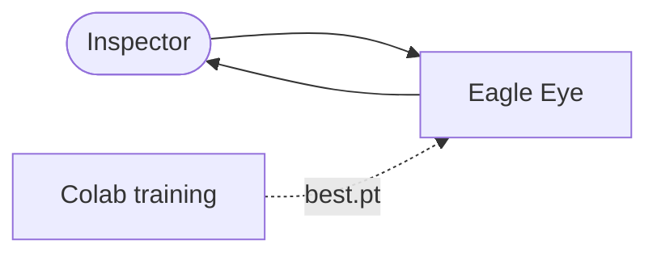

# Architecture

Diagram sources live in [docs/diagrams/](docs/diagrams/) (Mermaid). Workflow narrative: [SYSTEM_WORKFLOW.md](SYSTEM_WORKFLOW.md). API: [API.md](API.md). Data: [DATABASE.md](DATABASE.md). Nothing described here beyond the health endpoint is implemented yet.

## 1. Goals and principles
Separation of concerns · explicit API boundary · independent, replaceable model inference · testable business rules · typed schemas · centralised configuration · evidence traceability · safe file handling · versioned model artifacts · **no false confidence** (insufficient evidence gives `REVIEW`).

Three concepts are kept apart everywhere:
- **Expected configuration**: what engineering documents say.
- **Observed evidence**: what detection/OCR report from images, with confidence.
- **QC decision**: what a deterministic rule concludes, then what a human decides.

## 2. System context

Full version: [system-context.mmd](docs/diagrams/system-context.mmd). The inspector uses a browser; the only offline link is the manual copy of a trained checkpoint from Colab.

## 3. Major components
| Component (dir) | Responsibility | Why it exists |
|---|---|---|
| `frontend/` | UI, forms, result display | Presentation only; no inference, no rules |
| `backend/app/api` | HTTP routes, request validation, status codes | Thin boundary; delegates to services |
| `backend/app/schemas` | Pydantic request/response models | One typed contract shared with docs |
| `backend/app/services` | Orchestrates an inspection run and job lifecycle | Single place that sequences stages |
| `backend/app/parsers` | PDF/CSV/XLSX to `ExpectedItem` | Documents are a different domain from images |
| `backend/app/vision` | Image quality gate, preprocessing, YOLO wrapper | Isolates the model behind a `Detector` interface |
| `backend/app/ocr` | OCR engine wrapper | Swappable (`OcrEngine` interface) |
| `backend/app/matching` | Normalisation and expected-to-observed matching | Pure functions, easy to test |
| `backend/app/checks` | Deterministic rules R-001 to R-006 | Pure business logic, no I/O |
| `backend/app/reporting` | PDF/summary generation | Consumes stored results only |
| `backend/app/database` | SQLAlchemy models/repositories | Persistence only; no rules inside entities |
| `backend/app/storage` | Safe file save/read, evidence images | One place for path safety |
| `backend/app/core` | Settings, logging, errors | Centralised config |

Component diagram: [architecture.mmd](docs/diagrams/architecture.mmd).

## 4. Layers and dependency direction
`api → services → {parsers, vision, ocr, matching, checks, reporting, database, storage}`; `matching → checks` (rules consume matching output). `schemas` is used by everyone and depends on nothing. Lower layers **never import** `api` or `services`. `checks` and `matching` must not import `vision`, `ocr`, `database` or FastAPI: they take plain data objects, which is what makes them unit-testable without a model.

## 5. Boundaries
- **Frontend/backend:** JSON over HTTP under `/api`. The frontend never loads a model and never evaluates rules; it renders what the API returns.
- **API boundary:** contract in [API.md](API.md); errors use a common envelope.
- **Model inference boundary:** `Detector.detect(image) -> list[Detection]`. Backend code outside `vision/` sees class names, boxes, confidences and a model version, never Ultralytics objects. Replacing a model means replacing `best.pt` + `model_manifest.json`.
- **Data/persistence boundary:** repositories in `database/`; services open transactions; files live on disk, the DB stores relative paths.
- **File storage:** `UPLOAD_DIR/<inspection_id>/<file_id>.<ext>` with server-generated names (original names stored as metadata only).

## 6. Processing pipeline
1. **Document parsing:** table parsers (CSV/XLSX) are strict about columns; PDF parsing extracts selectable text/tables best-effort and flags failures.
2. **Image preprocessing/quality gate:** decode, fix EXIF orientation, measure resolution/blur/brightness.
3. **Detection:** YOLO inference with thresholds from settings; class IDs mapped to names from the manifest ([inference-pipeline.mmd](docs/diagrams/inference-pipeline.mmd)).
4. **OCR:** runs on the whole image (MVP) or on detected-component crops (enhancement).
5. **Matching:** normalise class names/tags; match by class, then tag text, then optional zone ([expected-vs-observed.mmd](docs/diagrams/expected-vs-observed.mmd)). Drawings are **never** pixel-compared with photos; they are different visual domains, so comparison happens on extracted structured data.
6. **Rules:** see the rule table in [REQUIREMENTS.md](REQUIREMENTS.md). Wiring correctness (R-006) is unsupported from photos and always returns `REVIEW`.

## 7. Evidence and reporting
Each `QC_CHECK` links to `EVIDENCE` rows referencing a source file, a detection/OCR record, and optionally a rendered overlay image. Reports read persisted checks, evidence, reviews and the model version; they never recompute results.

## 8. Error handling
Typed domain errors map to the API error envelope with a stable `code`. Stage failures set the job to `FAILED` with an error code and message (no stack traces to clients). Missing model gives `MODEL_NOT_AVAILABLE`; the rest of the app keeps working. Timeouts mark the job `FAILED` and allow retry. A per-image failure does not abort other images; it yields `REVIEW` checks with reason `IMAGE_PROCESSING_ERROR`.

## 9. Security boundaries
Untrusted: uploaded files and filenames. Trusted: server config and the model artifact (provenance recorded). No authentication in the MVP, so local/demo use only ([SECURITY.md](SECURITY.md)).

## 10. Deployment topology
Local/demo: Vite + Uvicorn + SQLite + local folder ([deployment.mmd](docs/diagrams/deployment.mmd), [DEPLOYMENT.md](DEPLOYMENT.md)).

## 11. Scaling considerations
MVP uses an in-process background task and a single worker; inference is CPU/GPU bound. Future: task queue (e.g., RQ/Celery), PostgreSQL, object storage, ONNX/TensorRT export, model server.

## 12. Decisions and trade-offs
| Decision | Rationale | Trade-off |
|---|---|---|
| Detector + OCR + rules, not one big model | Explainable, testable | More integration work |
| Class-level matching in MVP | Achievable; robust | No position/wiring validation |
| SQLite | Zero setup | Single writer; migrate later |
| In-process background job | Simple | Lost on restart; no horizontal scale |
| EasyOCR baseline (to be confirmed in a Phase 7 spike) | pip-only install tends to be simpler on Windows (unverified here) | Accuracy versus alternatives not measured |
| YOLO11n baseline checkpoint | Small, widely documented | AGPL-3.0 licensing implications |
Decision records go in [docs/decisions/](docs/decisions/README.md).

## 13. Known limitations
Photos cannot prove wiring; non-detection is not absence; occlusion, glare and angle degrade results; generic pretrained weights do not know cabinet-specific classes; PDF parsing is limited to selectable-text PDFs; no auth; single-process job runner.
