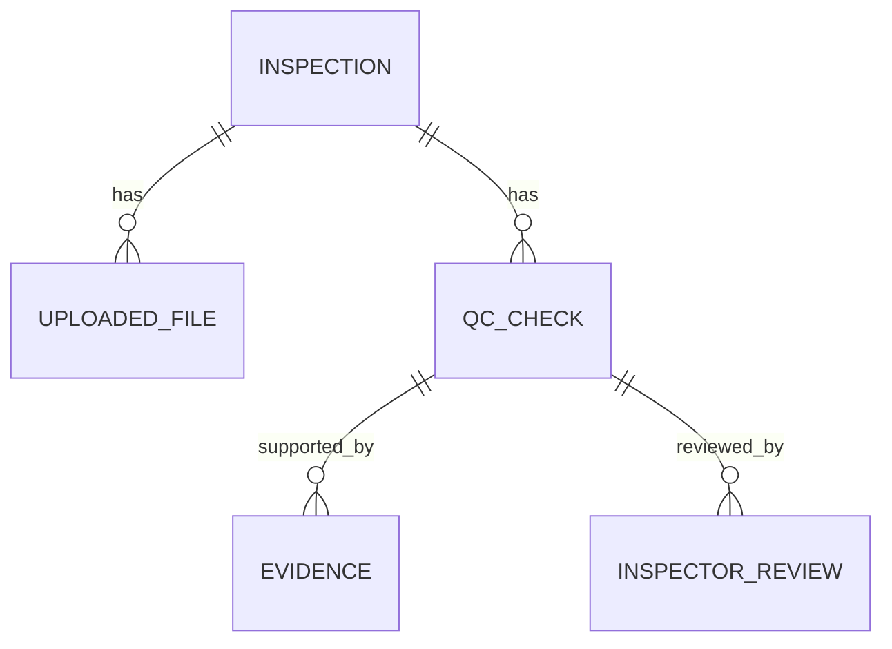

# Database (proposed data model)

SQLite via SQLAlchemy 2.x for the MVP. **Nothing here is implemented yet.** ER source: [database-erd.mmd](docs/diagrams/database-erd.mmd).

(Excerpt; see the full diagram file.)

## Plain-language summary
An **inspection** owns its **files**. Parsing a table creates **expected items**; running a model creates **detected objects** and **OCR observations**. A **processing job** records one run. Rules create **QC checks**; each check cites **evidence** (a detection, an OCR line, an image box). An **inspector review** is added later and never overwrites the machine result. A **report** is a generated file for an inspection.

## Entities
Types: `uuid`=text(36), `ts`=UTC datetime. All tables have `id uuid PK`, `created_at ts`.

**inspections**: cabinet_id text NOT NULL; project_ref text; inspection_date date; notes text; status text NOT NULL (enum); parent_inspection_id uuid FK→inspections NULL (reinspection, future).
**uploaded_files**: inspection_id FK NOT NULL; kind text NOT NULL; original_name text; stored_path text NOT NULL (relative); sha256 text; size_bytes int; mime text; width int NULL; height int NULL; quality_json text NULL.
**expected_items**: inspection_id FK; source_file_id FK; item_key text (from `item_id`); component_class text NOT NULL; tag text NULL; quantity int NOT NULL DEFAULT 1 CHECK(quantity>0); zone text NULL; raw_json text.
**processing_jobs**: inspection_id FK; state text NOT NULL; stage text; progress real; started_at, finished_at ts; error_code text; error_message text; model_name text; model_version text; model_sha256 text. Partial unique index: one job per inspection where state in (QUEUED, RUNNING).
**detected_objects**: job_id FK; file_id FK; class_name text NOT NULL; class_id int; confidence real CHECK 0..1; x,y,w,h real (pixels, original image coordinates); band text (`ACCEPTED`|`LOW`).
**ocr_observations**: job_id FK; file_id FK; text text; confidence real; x,y,w,h real; engine text.
**qc_checks**: inspection_id FK; job_id FK; rule text NOT NULL (R-001…); expected_item_id FK NULL; result text NOT NULL (PASS/FAIL/REVIEW); reason_code text NOT NULL; message text.
**evidence**: check_id FK; type text (`DETECTION`|`OCR`|`IMAGE`|`DOCUMENT_ROW`|`NONE`); file_id FK NULL; detected_object_id FK NULL; ocr_observation_id FK NULL; overlay_path text NULL.
**inspector_reviews**: check_id FK; reviewer text NOT NULL (free text in MVP, no accounts); decision text NOT NULL; comment text NOT NULL.
**reports**: inspection_id FK; job_id FK; stored_path text; format text; generated_at ts.

## Persistence design
- **Transactions:** one transaction per stage write-batch (e.g., all detections for one image); job state changes committed immediately so polling sees progress.
- **Indexes:** `inspections(created_at)`, `uploaded_files(inspection_id)`, `qc_checks(inspection_id, result)`, `detected_objects(job_id, file_id)`.
- **Files:** stored on disk; DB stores relative paths only; SHA-256 enables duplicate detection.
- **Reinspection history:** a new job per run; checks are tied to `job_id`; `parent_inspection_id` is reserved for linked reinspections. Old rows are kept.
- **Retention:** no automatic deletion in MVP; a manual delete procedure must remove DB rows and files together ([SECURITY.md](SECURITY.md)).
- **Migrations:** plan Alembic from Phase 2; migration path to PostgreSQL = change `DATABASE_URL`, avoid SQLite-specific SQL.
- **Rules are not stored in entities;** `checks/` computes them.
