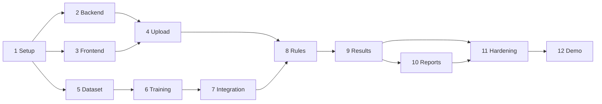

# PHASE.md — Implementation Roadmap

Twelve phases from the current scaffold to a tested, demonstrable MVP. Priorities: **P0** required for the MVP, **P1** should-have, **P2** optional/deferred. Requirement IDs: [REQUIREMENTS.md](REQUIREMENTS.md). Matching coding-agent prompts live in the local, git-ignored `PROMPT.md` (same phase numbers and commit messages).

The documentation package (architecture, API, database, dataset, model guides) is the "architecture and technical foundations" step; Phase 1 verifies it. The first end-to-end flow (Phases 1-9) comes before reports and polish. Reinspection (FR-018, P2) and checklist upload (FR-020, P2) are deferred beyond these phases.

## Summary table
| # | Phase | Priority | Depends on | Commit message |
|---|---|---|---|---|
| 1 | Repository initialization and project configuration | P0 | None. | `chore(setup): initialize Eagle Eye repository and verify tooling` |
| 2 | Backend API and persistence foundation | P0 | Phase 1. | `feat(api): establish inspection API and persistence foundation` |
| 3 | Frontend shell and shared components | P0 | Phase 1 | `feat(ui): add frontend shell and shared components` |
| 4 | File upload and document parsing | P0 | Phases 2 and 3. | `feat(ingest): implement validated uploads and expected-item parsing` |
| 5 | Public dataset selection and preparation | P0 | Phase 1 | `feat(data): add public dataset tooling and demo input generator` |
| 6 | Baseline model and Google Colab fine-tuning | P0 | Phase 5. | `docs(model): record baseline training results and manifest tooling` |
| 7 | Model integration, inference and OCR | P0 | Phases 4 and 6 | `feat(vision): integrate detector and OCR behind service interfaces` |
| 8 | Expected-versus-observed matching and QC rules | P0 | Phases 4 and 7. | `feat(inspection): implement expected-vs-observed matching and QC rules` |
| 9 | Inspection results, evidence review and history | P0 (results, history); P1 (inspector review) | Phase 8. | `feat(results): add evidence review, inspector decisions and history` |
| 10 | Reports and export | P1 | Phase 9. | `feat(reporting): generate inspection PDF reports` |
| 11 | Integration, testing and hardening | P0 | Phases 7 to 10 | `test(integration): verify end-to-end inspection workflow and harden uploads` |
| 12 | Final demo readiness and documentation review | P0 | Phase 11. | `docs(release): finalize setup, demo and limitations documentation` |

## Dependency diagram
Source: [docs/diagrams/phase-dependencies.mmd](docs/diagrams/phase-dependencies.mmd)

## Milestone checklist
- [ ] M1 Baseline green (Phase 1)
- [ ] M2 Inspections persisted via API (Phase 2)
- [ ] M3 UI shell talks to API (Phase 3)
- [ ] M4 Files uploaded and expected items parsed (Phase 4)
- [ ] M5 Dataset validated (Phase 5)
- [ ] M6 Model trained, evaluated, manifest written (Phase 6)
- [ ] M7 Detector + OCR job works (Phase 7)
- [ ] M8 Rules produce PASS/FAIL/REVIEW (Phase 8)
- [ ] M9 First complete inspection reviewed in the UI (Phase 9) — **first end-to-end demo**
- [ ] M10 Report (Phase 10, P1)
- [ ] M11 Hardened and measured (Phase 11)
- [ ] M12 Demo rehearsed (Phase 12)

---
## Phase 1 — Repository initialization and project configuration
**Priority:** P0  |  **Depends on:** None.

**Objective:** Turn the scaffold into a working Git repository with verified tooling and a green baseline.

**Detailed tasks**
- Initialize Git, confirm `.gitignore` ignores `/PROMPT.md` and not `PHASE.md`
- Create venv, install `requirements-dev.txt`, run `pytest` and `ruff`
- Install frontend deps, run `npm run typecheck` and `npm run build`; commit the generated lockfile
- Pin working dependency versions; correct any wrong version ranges in `pyproject.toml`/`package.json` and `TECH_STACK.md`
- Review all docs for consistency; run `python scripts/utilities/check_docs.py`
- Push to GitHub and confirm the first CI run (fix workflow problems honestly)

**Expected files**
- package-lock.json (frontend)
- updated pyproject.toml / requirements*.txt
- CHANGELOG.md

**Frontend work:** Verify the scaffold page loads and shows backend health.
**Backend work:** Verify `GET /api/health` and `test_health.py` pass.
**Dataset/model work:** None.

**Testing:** Existing health test, ruff, typecheck, build, doc check.

**Acceptance criteria**
- Clean clone to running app follows INSTALLATION.md without undocumented steps
- CI green or failures documented
- No secrets/weights/datasets tracked

**Deliverables**
- Verified baseline commit
- Pinned dependencies

**Risks and fallback:** Version conflicts on Windows. Fallback: pin older versions; use Python 3.11; use WSL.

**Definition of done:** All baseline commands pass locally; docs updated with real versions.

**Proposed Git commit message:** `chore(setup): initialize Eagle Eye repository and verify tooling`

---
## Phase 2 — Backend API and persistence foundation
**Priority:** P0  |  **Depends on:** Phase 1.

**Objective:** Build typed settings, error envelope, database models and the inspection create/list/get endpoints.

**Detailed tasks**
- Implement error envelope and exception handlers
- Add SQLAlchemy models and repositories for inspections, uploaded_files, processing_jobs (others later) per DATABASE.md
- Set up Alembic and the first migration
- Implement POST/GET /api/inspections and GET /api/inspections/{id}
- Add logging configuration and startup DB initialization
- Mark jobs left RUNNING as FAILED (INTERRUPTED) on startup

**Expected files**
- backend/app/core/errors.py
- backend/app/database/*.py
- backend/app/schemas/inspection.py
- backend/app/api/inspections.py
- backend/tests/test_inspections_api.py
- backend/tests/test_persistence.py

**Frontend work:** None (contract only).
**Backend work:** Routes, schemas, repositories, migrations.
**Dataset/model work:** None.

**Testing:** API tests with temp DB; persistence across app restart; validation errors (422).

**Acceptance criteria**
- FR-001, FR-002, FR-016 satisfied
- Responses match API.md
- Error envelope used everywhere

**Deliverables**
- Working inspection CRUD subset
- Migration scripts

**Risks and fallback:** Schema churn. Fallback: keep migrations small; recreate dev DB.

**Definition of done:** Tests pass; API.md updated if the contract changed; FR-001/002/016 marked implemented.

**Proposed Git commit message:** `feat(api): establish inspection API and persistence foundation`

---
## Phase 3 — Frontend shell and shared components
**Priority:** P0  |  **Depends on:** Phase 1 (contract from Phase 2 can be mocked).

**Objective:** Create the application shell, routing, typed API client and reusable components without fixing a final visual design.

**Detailed tasks**
- Add routing, layout, and error/loading states
- Typed API client and TypeScript types mirroring API.md
- Inspections list page and create-inspection form with validation
- Reusable components: ResultBadge (PASS/FAIL/REVIEW with text and icon, not color only), FileDropzone shell, StatusPill, EmptyState
- Install and configure shadcn/ui and an icon library; choose router and form libraries and record in TECH_STACK.md
- Set up Vitest + Testing Library

**Expected files**
- frontend/src/app/*
- frontend/src/pages/InspectionsPage.tsx
- frontend/src/pages/NewInspectionPage.tsx
- frontend/src/components/*
- frontend/src/services/api.ts
- frontend/src/types/*
- frontend/tests/*

**Frontend work:** All work in this phase.
**Backend work:** None.
**Dataset/model work:** None.

**Testing:** Component tests; typecheck; build.

**Acceptance criteria**
- Create and list inspections works against the Phase 2 backend
- Components are keyboard accessible
- No inference or rule logic in components

**Deliverables**
- App shell and component library

**Risks and fallback:** Over-designing. Fallback: unstyled but accessible components; the visual design is chosen later from your own references (no DESIGN.md).

**Definition of done:** Typecheck, tests and build pass; screenshots or notes of pages recorded.

**Proposed Git commit message:** `feat(ui): add frontend shell and shared components`

---
## Phase 4 — File upload and document parsing
**Priority:** P0  |  **Depends on:** Phases 2 and 3.

**Objective:** Accept validated photos and expected-configuration tables and convert tables into expected items; add best-effort PDF text extraction.

**Detailed tasks**
- Storage service: safe naming, path-traversal guard, size limits, content sniffing
- POST /api/inspections/{id}/files with kinds IMAGE, EXPECTED_TABLE, DRAWING_PDF
- CSV/XLSX parser with strict column schema and row-level errors
- PDF text extraction (PyMuPDF or pdfplumber; check licensing) flagged best-effort
- Persist expected_items and uploaded_files; compute SHA-256, image size
- Frontend upload UI on the inspection detail page with validation messages

**Expected files**
- backend/app/storage/*
- backend/app/parsers/tabular.py
- backend/app/parsers/pdf.py
- backend/app/api/files.py
- backend/tests/test_uploads.py
- backend/tests/test_upload_security.py
- backend/tests/test_parsers_tabular.py
- backend/tests/test_parsers_pdf.py
- frontend/src/features/uploads/*

**Frontend work:** Upload form, file list, parse summary and error display.
**Backend work:** Storage, parsers, endpoint.
**Dataset/model work:** None.

**Testing:** Security tests (traversal, spoofed type, oversize, empty); parser fixtures; frontend upload test.

**Acceptance criteria**
- FR-003, 004, 006 satisfied (FR-005 if time permits)
- Files stored only under UPLOAD_DIR with generated names
- Bad CSV returns row errors

**Deliverables**
- Upload and parsing pipeline

**Risks and fallback:** PDF variability. Fallback: CSV/XLSX only; mark PDF unsupported.

**Definition of done:** Tests pass; SECURITY.md updated to reflect implemented controls only.

**Proposed Git commit message:** `feat(ingest): implement validated uploads and expected-item parsing`

---
## Phase 5 — Public dataset selection and preparation
**Priority:** P0  |  **Depends on:** Phase 1 (can run in parallel with Phases 2-4).

**Objective:** Use public datasets only (no own data collection): the user checks images and downloads the chosen Roboflow dataset, verifies license and classes, places it in data/raw/, and the tooling validates it and produces demo inputs.

**Detailed tasks**
- User picks ONE dataset from DATASET.md after visually checking that its images are normal colour photos (not thermal, not drawings), downloads it in an Ultralytics YOLO format and unzips it to data/raw/<dataset-name>/ (hi-wxre3 is rejected: thermal)
- Read the license and class list from the dataset page and README files in the export; record them in DATASET_CARD.md (never guess)
- Run `scripts/dataset/validate_yolo_dataset.py` (supports Roboflow layout); the real Electrical Devices export showed cross-split leakage, so run `scripts/dataset/dedupe_and_resplit.py` into data/processed/electrical-devices-dedup, re-validate (0 errors) and use that folder for training; report unique image and per-class counts honestly
- Add `scripts/dataset/dataset_stats.py` (images and instances per class and split)
- Only if more datasets are added later: write `class_map.csv` and `scripts/dataset/merge_datasets.py` that remaps by class NAME; re-validate
- Test `scripts/utilities/labels_to_expected_csv.py` on the real export; generate one demo photo + expected CSV into data/interim/demo/ (not committed)
- Update DEMO_INPUTS.md with the real class names and one verified example

**Expected files**
- scripts/dataset/dataset_stats.py
- scripts/dataset/merge_datasets.py (only if merging)
- tests for the scripts using synthetic fixtures
- DATASET_CARD.md (filled)
- data/interim/demo/* (local only)

**Frontend work:** None.
**Backend work:** None.
**Dataset/model work:** Dataset selection, validation and statistics only (no training).

**Testing:** Unit tests for stats/merge scripts on synthetic data; validator reports 0 errors on the real download.

**Acceptance criteria**
- Validator reports 0 errors on the de-duplicated, re-split dataset (no cross-split duplicates)
- License and class list recorded from the real page
- A demo image + expected CSV pair exists locally and uses the model's class names
- No dataset image or label is committed

**Deliverables**
- Validated dataset in data/raw/ (not committed)
- Filled dataset card
- Demo input pair

**Risks and fallback:** Dataset is small or mislabeled. Fallback: pick the next dataset in DATASET.md; restrict the demo to classes with enough instances; state limits honestly.

**Definition of done:** Dataset validated, documented and ready to zip for Colab; nothing from the dataset committed.

**Proposed Git commit message:** `feat(data): add public dataset tooling and demo input generator`

---
## Phase 6 — Baseline model and Google Colab fine-tuning
**Priority:** P0  |  **Depends on:** Phase 5.

**Objective:** Train, evaluate and select a checkpoint, producing best.pt and a complete manifest. Training is run by the human in Colab.

**Detailed tasks**
- Regenerate/open the Colab notebook
- Run smoke test, then full training; save runs to Drive
- Evaluate on val and (once) test; record per-class metrics and review prediction images
- Write `model_manifest.json` with real values; fill MODEL_CARD.md and MODEL_EVALUATION.md tables
- Copy `best.pt` and manifest into `models/custom/` locally (do not commit)

**Expected files**
- models/custom/model_manifest.json (local)
- MODEL_CARD.md (filled)
- reports/model_eval_v1.md (local)

**Frontend work:** None.
**Backend work:** None.
**Dataset/model work:** Training and evaluation on the validated public dataset (data/raw/<name>). If the dataset has no test split, evaluate on the validation split only and document that in MODEL_CARD.md.

**Testing:** Manifest schema check script; qualitative review.

**Acceptance criteria**
- Real metrics recorded exactly as measured
- Manifest class names equal weights' names
- Checkpoint SHA-256 recorded

**Deliverables**
- best.pt (local only)
- Filled model card and manifest

**Risks and fallback:** Poor metrics. Fallback: mark weak classes unsupported (REVIEW); collect more data; use public baseline for demo plumbing only.

**Definition of done:** Model files present locally and documented; nothing fabricated.

**Proposed Git commit message:** `docs(model): record baseline training results and manifest tooling`

---
## Phase 7 — Model integration, inference and OCR
**Priority:** P0  |  **Depends on:** Phases 4 and 6 (a fake detector allows progress before Phase 6 is done).

**Objective:** Run the trained detector and OCR behind clean interfaces and add the asynchronous processing job.

**Detailed tasks**
- Detector interface + Ultralytics implementation; manifest loading and validation; model status endpoint
- Image quality gate and preprocessing (OpenCV)
- OCR interface + EasyOCR implementation (confirm choice in a short spike; record in a decision record)
- POST /api/inspections/{id}/process (202), GET .../status; job runner with timeout, duplicate protection, retry
- Persist detected_objects and ocr_observations with model version
- Fake detector for tests; missing-model error path

**Expected files**
- backend/app/vision/*
- backend/app/ocr/*
- backend/app/services/processing.py
- backend/app/api/processing.py
- backend/tests/test_detector.py
- backend/tests/test_ocr.py
- backend/tests/test_processing_jobs.py

**Frontend work:** Process button and polling progress display on inspection detail.
**Backend work:** All of the above.
**Dataset/model work:** Place weights under models/custom/ locally.

**Testing:** Fake-detector tests, missing-model test, timeout test, optional `@pytest.mark.model` test with real weights.

**Acceptance criteria**
- FR-007, 008, 009 (P1), 019 (P1) satisfied
- No Ultralytics types leak outside vision/
- Job states per API.md
- Latency measured and recorded

**Deliverables**
- Working detection and OCR pipeline

**Risks and fallback:** Slow CPU inference, OCR install problems. Fallback: smaller imgsz, skip OCR (R-003 returns REVIEW), PaddleOCR or Tesseract alternative.

**Definition of done:** Real image processed end to end to stored detections; docs updated.

**Proposed Git commit message:** `feat(vision): integrate detector and OCR behind service interfaces`

---
## Phase 8 — Expected-versus-observed matching and QC rules
**Priority:** P0  |  **Depends on:** Phases 4 and 7.

**Objective:** Implement normalization, matching and rules R-001 to R-006 as pure, tested logic and wire them into the job.

**Detailed tasks**
- Class alias normalization configuration
- Matching by class, tag text and optional zone
- Rules R-001 to R-006 returning result + reason_code + message + evidence refs
- R-006 always REVIEW (unsupported)
- Persist qc_checks and evidence; overlay image rendering
- GET /api/inspections/{id}/results

**Expected files**
- backend/app/matching/*
- backend/app/checks/*
- backend/tests/test_matching.py
- backend/tests/test_rules.py
- backend/tests/test_rules_wiring.py
- backend/tests/test_normalization.py

**Frontend work:** Basic results table (ResultBadge, reason, link to evidence).
**Backend work:** All of the above.
**Dataset/model work:** Use thresholds from the manifest-based evaluation.

**Testing:** Table-driven rule tests with plain data; no model or DB in rule tests.

**Acceptance criteria**
- FR-010 to FR-013 satisfied
- Unsupported/insufficient evidence never PASS
- Non-detection never produces PASS and its policy is documented

**Deliverables**
- Rule engine and results endpoint

**Risks and fallback:** Ambiguous FAIL vs REVIEW policy. Fallback: default to REVIEW (Q-004).

**Definition of done:** Rules documented in REQUIREMENTS.md match code; tests pass.

**Proposed Git commit message:** `feat(inspection): implement expected-vs-observed matching and QC rules`

---
## Phase 9 — Inspection results, evidence review and history
**Priority:** P0 (results, history); P1 (inspector review)  |  **Depends on:** Phase 8.

**Objective:** Let the inspector see results with evidence, review uncertain items, and browse history.

**Detailed tasks**
- Evidence endpoint and image overlay viewer with bounding boxes
- Results page: filter by PASS/FAIL/REVIEW, evidence panel, unexpected items
- Inspector review endpoint and UI with required comment; state transition to COMPLETED
- History list with summary counts
- Accessibility pass (labels, focus, not color-only)

**Expected files**
- backend/app/api/evidence.py
- backend/app/api/reviews.py
- backend/tests/test_evidence.py
- backend/tests/test_review.py
- frontend/src/features/results/*
- frontend/src/features/review/*

**Frontend work:** Results, evidence viewer, review form, history.
**Backend work:** Evidence + review endpoints.
**Dataset/model work:** None.

**Testing:** API tests (evidence belongs to inspection, review immutability); component tests.

**Acceptance criteria**
- FR-014, 015, 016 satisfied
- Machine results are never overwritten by reviews
- Evidence IDs cannot access other inspections

**Deliverables**
- End-to-end inspection flow in the UI

**Risks and fallback:** Overlay rendering bugs. Fallback: send box metadata and draw in the client canvas.

**Definition of done:** A full inspection can be run and reviewed through the UI.

**Proposed Git commit message:** `feat(results): add evidence review, inspector decisions and history`

---
## Phase 10 — Reports and export
**Priority:** P1  |  **Depends on:** Phase 9.

**Objective:** Generate a downloadable PDF report from stored results.

**Detailed tasks**
- Report builder in reporting/ reading persisted data only
- GET /api/inspections/{id}/report
- Include summary, checks, evidence thumbnails, model version, review decisions, limitations statement
- Frontend download button

**Expected files**
- backend/app/reporting/*
- backend/app/api/report.py
- backend/tests/test_report.py

**Frontend work:** Download action.
**Backend work:** Report generation.
**Dataset/model work:** None.

**Testing:** Generate a report from fixture data; check PDF opens and contains expected text.

**Acceptance criteria**
- FR-017 satisfied
- Report never recomputes results

**Deliverables**
- PDF report

**Risks and fallback:** Layout time sink. Fallback: simple table-only PDF or HTML print view.

**Definition of done:** Report downloaded and visually checked.

**Proposed Git commit message:** `feat(reporting): generate inspection PDF reports`

---
## Phase 11 — Integration, testing and hardening
**Priority:** P0  |  **Depends on:** Phases 7 to 10 (10 optional).

**Objective:** Verify the whole workflow, harden security and measure performance.

**Detailed tasks**
- End-to-end integration test with fake and real detector
- Failure tests: missing model, parser error, timeout, duplicate process, restart recovery
- Security review against SECURITY.md; pip audit and npm audit; secret scan
- Measure latency, memory; record in MODEL_EVALUATION.md
- End-to-end evaluation on a small ground-truth set; record false-PASS rate
- Fix defects found

**Expected files**
- tests/test_e2e.py
- scripts/evaluation/measure_latency.py
- scripts/evaluation/e2e_eval.py

**Frontend work:** Fix UX issues found.
**Backend work:** Hardening.
**Dataset/model work:** Threshold tuning with evidence.

**Testing:** Entire suite; manual E2E script.

**Acceptance criteria**
- All P0 requirements verified or documented as gaps
- No known false PASS in the demo set

**Deliverables**
- Test report
- Updated docs

**Risks and fallback:** Late discovery of defects. Fallback: cut P1 features; document limitations.

**Definition of done:** CI green; TESTING.md matches reality.

**Proposed Git commit message:** `test(integration): verify end-to-end inspection workflow and harden uploads`

---
## Phase 12 — Final demo readiness and documentation review
**Priority:** P0  |  **Depends on:** Phase 11.

**Objective:** Prepare a reliable demo and make documentation match the final system.

**Detailed tasks**
- Write a demo script and a backup recording plan
- Prepare authorised demo data; verify setup from a clean clone
- Update README feature status (planned/implemented/verified) truthfully
- Update FINAL_REVIEW.md, CHANGELOG.md, MODEL_CARD.md, THIRD_PARTY_NOTICES.md from real installs
- Decide the license (LICENSE.md)
- Tag release candidate

**Expected files**
- docs/DEMO_SCRIPT.md
- README.md
- FINAL_REVIEW.md
- CHANGELOG.md

**Frontend work:** Final polish only.
**Backend work:** Bug fixes only.
**Dataset/model work:** Final model manifest check.

**Testing:** Clean-clone setup run; full demo rehearsal.

**Acceptance criteria**
- Demo runs end to end twice in a row
- All docs consistent; limitations stated

**Deliverables**
- Demo-ready repository
- Final documentation

**Risks and fallback:** Overpromising. Fallback: demo only verified features.

**Definition of done:** Rehearsal done; docs reviewed.

**Proposed Git commit message:** `docs(release): finalize setup, demo and limitations documentation`
