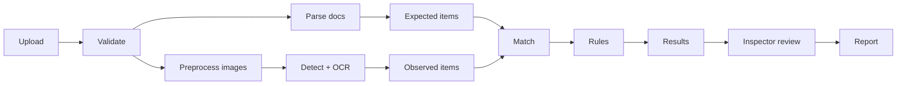

# System Workflow

Proposed lifecycle; **not implemented**. Diagrams: [data-flow.mmd](docs/diagrams/data-flow.mmd), [inspection-sequence.mmd](docs/diagrams/inspection-sequence.mmd), [inspection-state-machine.mmd](docs/diagrams/inspection-state-machine.mmd).

## Simple version
1. Inspector creates an inspection.
2. Uploads photos and the expected-configuration file.
3. System checks file type and size.
4. System parses documents.
5. System extracts the expected items.
6. System prepares the images.
7. YOLO detects components.
8. OCR reads text where useful.
9. Results are converted to one common format.
10. Expected and observed items are matched.
11. Rules decide PASS / FAIL / REVIEW.
12. Uncertain items become review items.
13. The inspector reviews them.
14. Results and evidence are saved.
15. A report is generated.
16. (Optional later) the cabinet is reinspected and history compared.

## Detailed flow

## Stage notes
| # | Stage | Input → Output | Failure behaviour |
|---|---|---|---|
| 3 | Validate | file → accepted/rejected | Reject immediately with 413/415/422 |
| 4–5 | Parse | table/PDF → ExpectedItem list | Row errors returned; PDF unreadable → flagged unsupported |
| 6 | Preprocess | image → normalised image + quality metrics | Corrupt image → per-image error → REVIEW |
| 7 | Detect | image → detections | Model missing → job fails `MODEL_NOT_AVAILABLE` |
| 8 | OCR | image/crops → text observations | OCR failure → R-003 returns REVIEW |
| 10 | Match | expected + observed → pairs, leftovers | Unknown class alias → REVIEW |
| 11 | Rules | matches → checks | Unsupported rule → REVIEW |
| 14 | Save | checks/evidence → DB + files | Transaction rollback; job FAILED |

## Failure and retry paths
- **Job failure/timeout:** inspection status `FAILED`; retry calls `process` again (new job, old job kept).
- **Duplicate process requests:** rejected 409 while a job is active.
- **Partial failure:** images are independent; one bad image does not stop the run.
- **Server restart mid-job:** MVP job is lost; on startup, jobs left `RUNNING` are marked `FAILED` (`error_code: INTERRUPTED`).
- **Insufficient evidence:** always `REVIEW`, never an inferred PASS/FAIL.

## Sequence
See [inspection-sequence.mmd](docs/diagrams/inspection-sequence.mmd): browser → API → job → services → DB, with polling for status.
